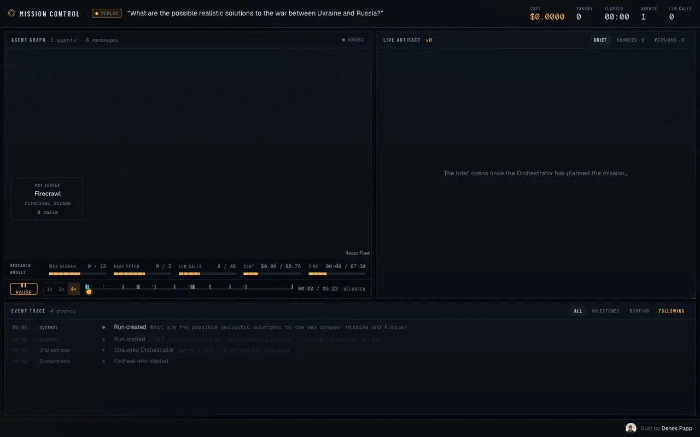
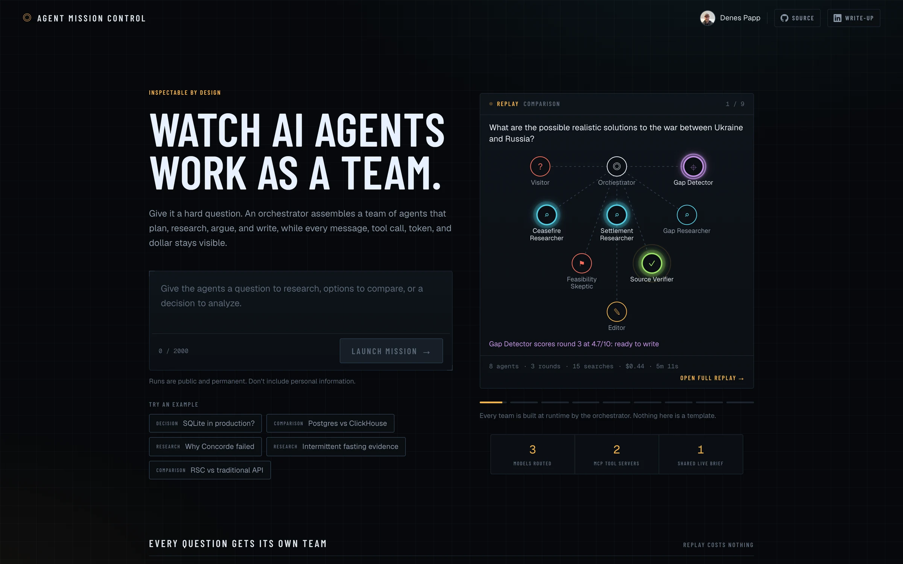
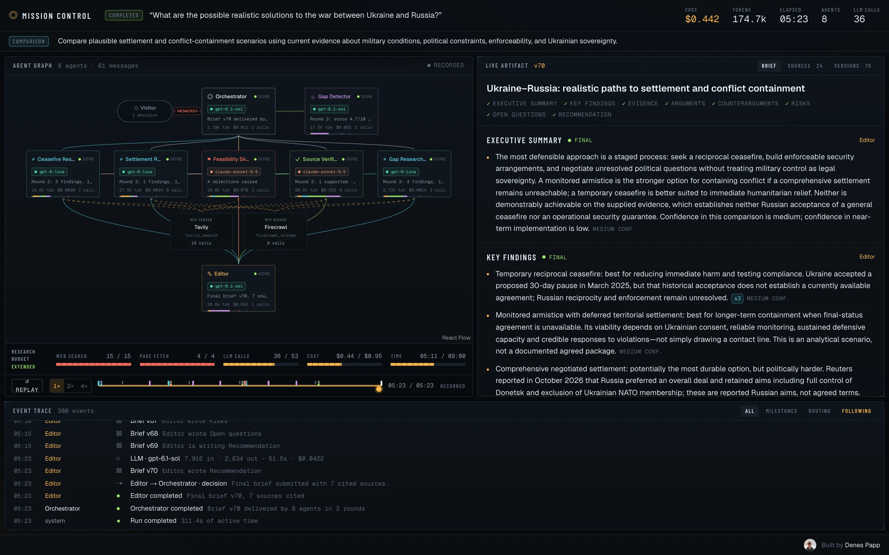
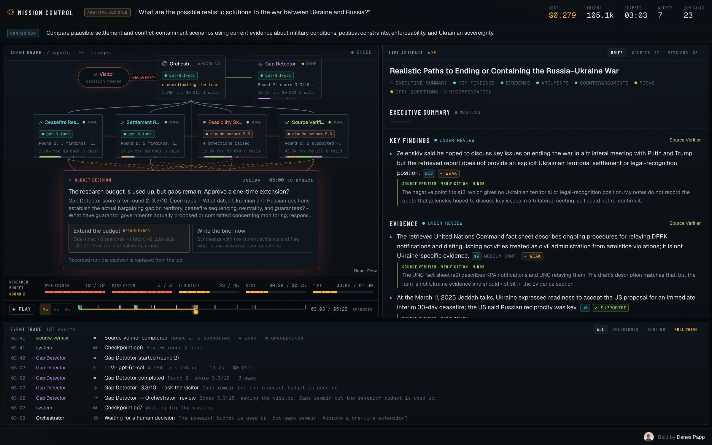
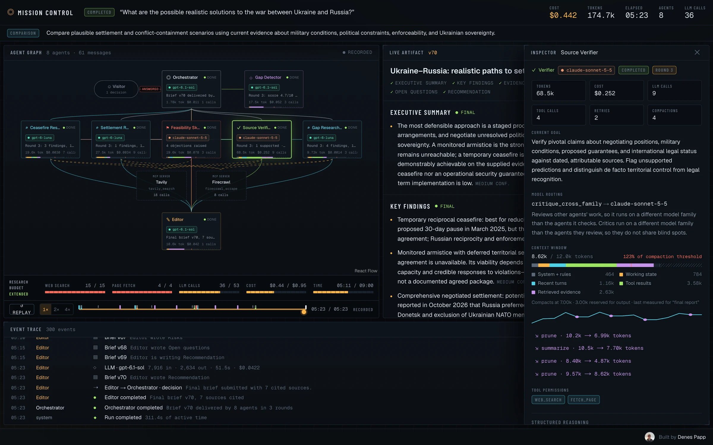
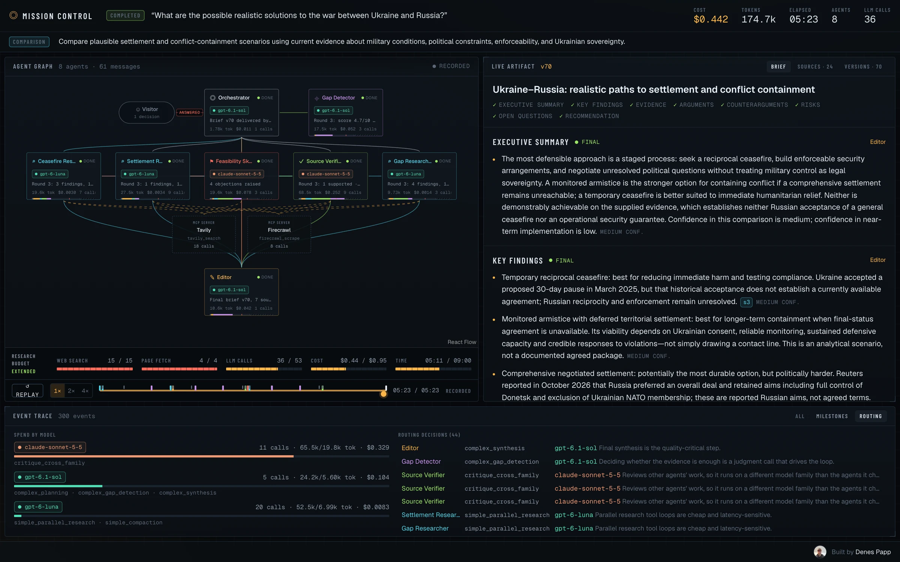
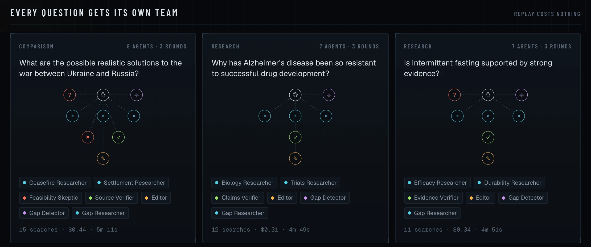

<h1 align="center">◎ Agent Mission Control</h1>

<p align="center">
  <strong>Watch AI agents work as a team.</strong><br>
  Prompt in, a small team of agents out, and a live graph, trace and artifact view of the whole run.
</p>

<p align="center">
  <a href="https://www.agentmissioncontrol.dev"><strong>Live demo</strong></a> ·
  <a href="https://www.agentmissioncontrol.dev/run/jfqO2FjlhJK4EWGw?play=1">Watch a full replay</a> ·
  <a href="docs/architecture.md">Architecture</a>
</p>

<p align="center">
  <a href="https://www.agentmissioncontrol.dev/run/jfqO2FjlhJK4EWGw?play=1">
    
  </a>
</p>

Give it a hard question. An orchestrator assembles a team of agents at runtime that plan, research, argue and write, while every message, tool call, token and dollar stays visible. The same event log drives the live view and the replay, so any run can be watched again for free. See [docs/architecture.md](docs/architecture.md) for how it works and why.

<p align="center">
  
</p>

## A tour of a run

### Mission control

Agent graph on the left, the live brief on the right, the full event trace underneath. Header metrics track cost, tokens, elapsed time and LLM calls, and the budget bar shows what the team has left.



### Human in the loop

When the Gap Detector finds gaps but the research budget is used up, the run pauses and asks whoever is watching. The first answer wins, the recommended option is used on timeout, and the budget clock stops while it waits.



### Inspect any agent

Click a node to see its goal, model routing decision and reason, context window breakdown, every compaction, and its tool permissions.



### Model routing and spend

Named rules send each call to a model: cheap and fast for parallel research, a different model family for critics, the strongest model for planning and synthesis. The Routing tab shows spend per model and every decision with its reason.



### Every question gets its own team

Nothing is a template. The orchestrator picks the roles, names and size of the team per question.



## Setup

1. Apply the schema with `pnpm supabase db push`. RLS is enabled with no policies; only the server (secret key) can read or write, and only the server can call `create_run`.
2. Environment variables (`.env.local`):
   `OPENAI_API_KEY`, `ANTHROPIC_API_KEY`, `TAVILY_API_KEY`, `FIRECRAWL_API_KEY`, `SUPABASE_URL`, `SUPABASE_SECRET_KEY`, `TRIGGER_SECRET_KEY`, optional `IP_HASH_SALT`, optional `OPERATOR_TOKEN`.
3. Run the app and the Trigger.dev worker side by side:

```bash
pnpm dev
npx trigger.dev@latest dev
```

## Layout

- `src/harness/` runtime-agnostic agent harness (event bus, budget, model routing, tool registry, MCP adapter, artifact, roles, runtime). No framework or database imports.
- `src/server/` Supabase store, moderation, rate limits.
- `src/trigger/run-mission.ts` thin Trigger.dev wrapper around the harness.
- `app/api/runs/[id]/events` SSE endpoint used for both live and replayed runs.
- `src/components/` event-sourced UI (`src/harness/view.ts` reducer).

BotID (`botid` package) protects the run-creation server action; it only verifies on Vercel deployments and is a no-op in local dev.

Run creation is limited per IP (1 active, 3 per hour, 10 per day). To skip those limits for your own testing, set `OPERATOR_TOKEN` in the app's environment (only the Next.js server reads it) and store the same value in an `amc-operator` cookie from the browser console:

```js
document.cookie = "amc-operator=<OPERATOR_TOKEN>; Path=/; Max-Age=2592000; SameSite=Lax; Secure" // drop "; Secure" on http://localhost
```

Moderation, BotID and the global daily spend cap still apply. Without `OPERATOR_TOKEN` the cookie does nothing.

## Local harness run (no database, no Trigger.dev)

```bash
pnpm tsx --env-file=.env.local scripts/run-local.mts "your prompt"
# halve the context budgets so compaction happens, then simulate a crash after cp3 and resume from it
pnpm tsx --env-file=.env.local scripts/run-local.mts --low-context --resume-from=cp3 "your prompt"
```

Human decisions are auto-answered with the recommended option after 1.5 s. The event log is written to `/tmp/amc-local-events.json`.

## Tests

```bash
pnpm test        # vitest: reducer and replay on recorded runs, checkpoint round trip, compaction, decision rule
pnpm test:e2e    # Playwright: landing reel and cards (desktop and phone), replay controls, human-decision card
```

`tests/fixtures/*.json` are event logs from real local runs. With `E2E_FIXTURES=1`, `/run/fixture-*` renders without a database row, the tests serve the SSE stream from the fixture, and the landing page features the fixtures.

## Landing page showcase

The hero reel plays a 10-second compressed preview of each featured run in turn, and the cards below show each run's team side by side. Both read `runs.preview`, a small digest (`src/harness/preview.ts`) built from the event log the first time a featured run is loaded and cached on the row. Curate the list with:

```bash
pnpm feature                    # list recent completed runs and their featured position
pnpm feature <id> <id> ...      # feature exactly these runs, in this order
pnpm feature --unfeature <id>   # remove a run from the landing page
```

## Harness at a glance

- **Phase state machine** (`src/harness/runtime.ts`): plan, research, critique, evaluate, HITL, synthesize. A checkpoint is written after every transition; a Trigger.dev retry resumes from the latest one (`run.resumed`).
- **Gap Detector and loops** (`src/harness/evaluator.ts`): scores the draft, names gaps, and the pure `decideNext` rule picks synthesize, another round (re-tasked researchers, an optional verifier or extra researcher), or a human decision.
- **Human in the loop** (`src/harness/approvals.ts`, `src/trigger/approvals.ts`): Trigger.dev wait tokens; anyone viewing a live run can answer, the first answer wins, and the recommended option is used on timeout. The budget clock is paused while waiting.
- **Context management** (`src/harness/context-window.ts`): per-agent context measurement, pruning of handed-in material first, then LLM summaries of older tool turns (deterministic truncation as fallback). Every compaction is inspectable.
- **Model routing** (`src/harness/router.ts`): named per-call rules in `config.ts`, escalation for large prompts, provider fallback; the Routing tab shows decisions and spend per model.
- **Budgets**: live `budget.updated` snapshots, per-agent search allowances, a search reserve for follow-up rounds, and a one-time extension a visitor can approve.
- **Replay** (`src/components/use-run-player.ts`): the same event log drives live view and replay, with speed control, milestone markers and jump-to-event from the trace.
